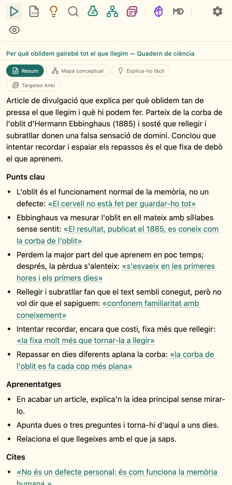

# Guia d'inici de Resumir

Resumir et fa un resum clar de qualsevol pàgina, vídeo de YouTube, fil o PDF, amb
cites que pots comprovar a l'original. En tres passos ho tens a punt.

---

## 1. Instal·la l'extensió

**Firefox:** a [addons.mozilla.org/firefox/addon/resumir](https://addons.mozilla.org/firefox/addon/resumir/),
clica **«Afegeix a Firefox»**.

**Chrome, Edge o Brave:** baixa el fitxer `…-chromium.zip` de
l'[última versió](https://github.com/xxxaau/resumir/releases/latest) i
descomprimeix-lo. Obre `chrome://extensions`, activa el **«Mode de
desenvolupador»**, clica **«Carrega extensió desempaquetada»** i tria la carpeta.

---

## 2. Posa la teva clau de Gemini

Resumir funciona amb Google Gemini i necessita una **clau d'API**, gratuïta i sense
targeta. Crea-la a [aistudio.google.com](https://aistudio.google.com/app/apikey) i
enganxa-la a **Configuració (⚙️) → General → Claus i models**. El botó
**«Comprovar»** et diu si funciona.

👉 Pas a pas: **[com obtenir la clau](./API-KEY-GOOGLE.md)**.

---

## 3. Fes el primer resum

1. Obre un article, un vídeo de YouTube, un fil o un PDF.
2. Obre Resumir amb la icona de l'extensió i clica **«Resumir aquesta pàgina»**,
   o prem **Alt+Maj+S**. També pots fer clic amb el botó dret i triar «Resumir
   aquesta pàgina» o, amb text seleccionat, «Resumir la selecció».
3. En pocs segons tens l'essencial, els punts clau, els aprenentatges i les cites.

**Comprova-ho.** Cada punt clau acaba amb una cita literal: clica-la i la pàgina la
ressalta en groc i hi va (no en PDF ni en vídeos). Als vídeos, les marques de temps
fan saltar el vídeo a aquell moment, i als PDF de la web, els números de pàgina són
enllaços. Sota el resum veus de quantes paraules parteix, amb quin model s'ha fet i
l'enllaç **«Veure el text enviat»**.

Si fas més d'un resum de la mateixa pàgina (Resum, Mapa conceptual…), surten en
**pestanyes** a dalt, i tornar-hi no gasta res. A baix pots canviar de **model** i
obrir l'**historial**.

👉 Què més pots fer: **[guia de plugins](./PLUGINS.md)**.

---

## La configuració

Obre-la amb l'engranatge (⚙️) de la barra lateral:

- **General:** la clau d'API, el model i el tema (Sistema, Flexoki automàtic, Clar,
  Fosc, Flexoki clar o Gris clar).
- **Resum:** el format i la llargada del resum, i les instruccions si vols anar més
  enllà.
- **Plugins:** quines eines surten a la barra i en quin ordre.
- **Dades i privadesa:** on es desa cada dada, l'historial, les estadístiques d'ús i
  la **còpia de seguretat** (exporta i importa la configuració en un fitxer; la
  clau només hi va si ho demanes).

**Privadesa:** la clau i l'historial es queden en aquest ordinador. Les
preferències es poden sincronitzar amb el teu navegador. El text de la pàgina i les
instruccions només van a Google Gemini quan demanes un resum. Resumir no té cap
servidor propi ni telemetria.

---

## Si alguna cosa no va

**«La clau no és vàlida»:** torna-la a copiar sencera, sense espais. Més detall a
la [guia de la clau](./API-KEY-GOOGLE.md#problemes-habituals).

**No veig la icona:** fixa Resumir a la barra des del botó d'extensions (la peça
del trencaclosques).

**Error de límit:** el nivell gratuït de Gemini limita les peticions per minut.
Espera uns segons i torna-ho a provar.

**Falta un botó a la barra:** activa'l a Configuració → Plugins.

---

Dubtes o errors: [GitHub Issues](https://github.com/xxxaau/resumir/issues).
